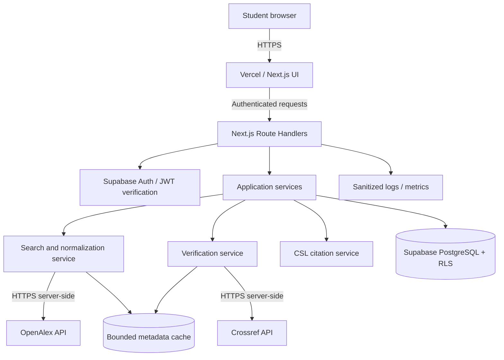
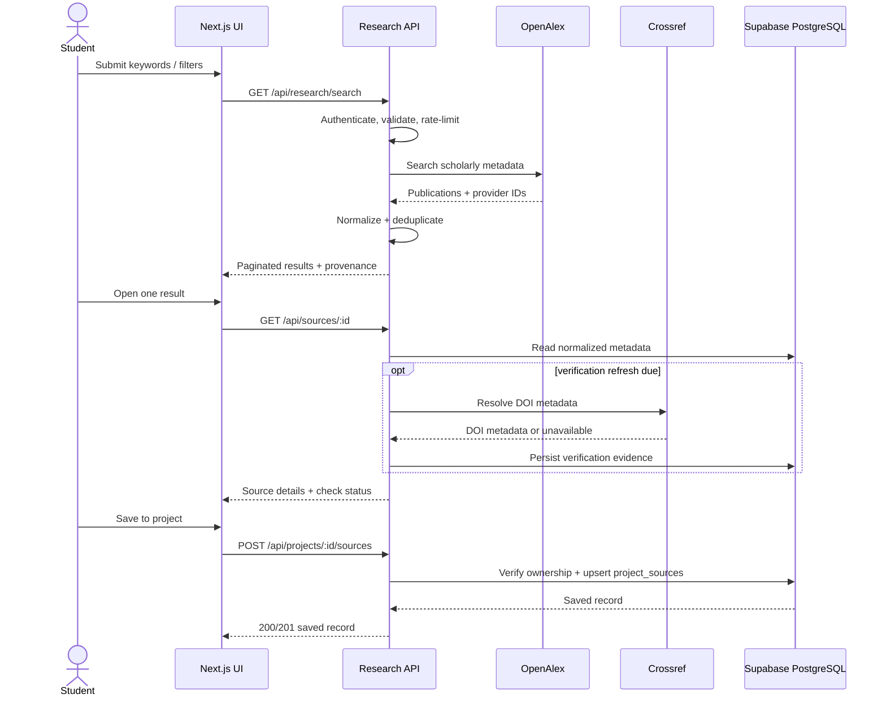
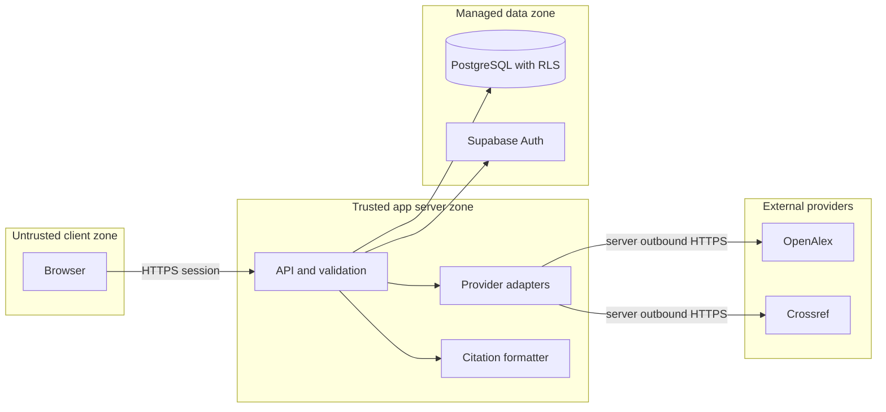
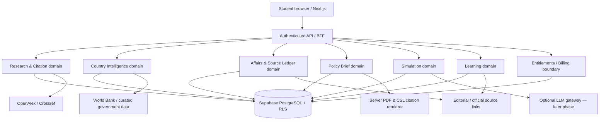
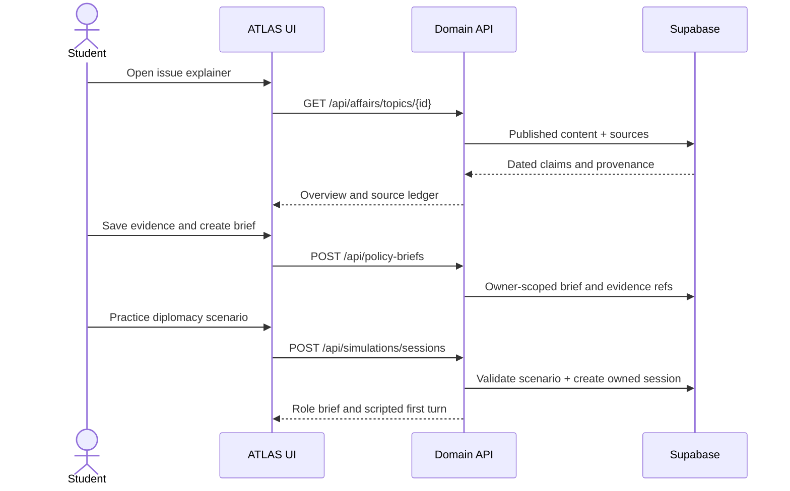

# System Architecture Document (SAD)

**ATLAS MVP 1.0 | Proposed architecture | 2026-11-11**

## 1. Context and technology decisions

ATLAS is a multi-user web application with a managed relational backend and third-party scholarly metadata integrations. Web clients must not access provider API credentials or privileged database credentials directly.

- UI: Next.js App Router / React / TypeScript, Tailwind CSS, shadcn/ui.
- API: Next.js server route handlers and service modules; runtime input validation with Zod.
- Auth + database: Supabase Auth, PostgreSQL, Row Level Security (RLS).
- Provider adapters: OpenAlex for discovery; Crossref for DOI metadata corroboration.
- Citation engine: Citation Style Language processor, e.g. citeproc-js with vetted APA 7 style assets.
- Hosting: Vercel for Next.js, Supabase managed DB/Auth.
- AI: not required in P0; optional controlled server-side enhancement later.

## 2. Container/component diagram

### Modules and ownership

| Module | Responsibility | Must not do |
|---|---|---|
| UI | Compose searches, render source evidence, edit project content | Call privileged provider endpoints with secrets |
| Auth middleware/service | Resolve authenticated identity and guard requests | Assume a project ID implies ownership |
| Search adapter | Validate query; call OpenAlex; normalize and dedupe | Present unverified metadata as vetted claims |
| Verification adapter | Compare metadata with Crossref; persist status and evidence | Infer factual correctness or peer review |
| Project service | CRUD for owned projects and saved sources | Accept arbitrary `user_id` as authority |
| Notes service | Manage notes belonging to owned project source | Write notes to a global source |
| Citation service | Build CSL-JSON and format APA 7 | Make up missing metadata |
| Persistence | Data integrity, FKs, RLS, indexes | Allow client writes to normalized source metadata |

## 3. Main sequence: discovery to saving

**Implementation clarification:** Search results must first be normalized and persisted by a trusted backend before `/api/sources/:id` and project-saving can use a canonical UUID; alternatively use a server-side source-resolution endpoint to persist on demand. Never trust client-supplied metadata as authoritative.

## 4. Network and trust boundaries

- Browser input is untrusted even after authentication.
- Third-party metadata is untrusted **data**, never instructions or a source of authorization.
- Service-role database access is reserved for narrow server-only ingestion processes; user CRUD ideally uses user-scoped RLS credentials.
- DOI and external URL fields must be normalized; only allow `https://` external navigation and prevent server-side arbitrary URL fetching (SSRF).

## 5. Request, storage, and caching lifecycle

1. Validate query length, filter formats and pagination; authorize session.
2. Search cache with normalized key and short TTL; avoid caching user-specific annotations in a shared cache.
3. Request provider through an adapter; handle timeout, 429 and invalid data.
4. Normalize metadata; upsert shared sources only via backend worker/service using constrained permissions.
5. Record verification evidence on-demand/asynchronously when practical, with `checked_at` and provider name.
6. Return provenance, verification caveat and external original URL.
7. Save project-specific associations via an authenticated/RLS-enforced request.
8. Export bibliography by selecting from the student's project and transforming to CSL-JSON.

### Caching strategy

- Search result caches may store **public bibliographic metadata only** for a short, configurable TTL.
- Metadata resolution status has its own TTL and may remain `unknown` if provider checks fail.
- Notes, projects and other personal data are never cached in cross-user keys.
- Respect provider terms, rate limits and cache directives.

## 6. Deployment environments

| Environment | Purpose | Data policy |
|---|---|---|
| Local | Developer work and unit tests | Synthetic data only |
| Preview/staging | Integration, QA, automated E2E | Separate Supabase project; test accounts |
| Production | Student beta | Separate keys, migrations, backups, alerting |

Environment secrets: Supabase server-only credentials, third-party API tokens (if required), telemetry credentials. Public Supabase URL and publishable/anon key alone are not privileged but must still be paired with correct RLS.

## 7. Architectural decision records (ADRs)

- **ADR-001 — Web-first:** Responsive website before mobile native apps; avoids duplicate development and makes academic workflows desktop-friendly.
- **ADR-002 — Shared metadata / private annotations:** Bibliography records are globally reusable, user notes live under saved join rows; prevents duplication and data leakage.
- **ADR-003 — OpenAlex primary search:** Start with one provider and explicit adapter contract; add providers after observing discovery gaps.
- **ADR-004 — Crossref verification is not truth verification:** Metadata confidence indicators must state exactly what was tested.
- **ADR-005 — No P0 generative AI:** Evidence-first product reduces cost, unsupported claims and scope risk.
- **ADR-006 — CSL citations:** Deterministic formatting and test fixtures instead of freeform text generation.

## 8. Capacity and failures

Plan for an initial limited student beta, not unproven massive-scale traffic. Log P50/P95 latency, failure and provider throttling ratios. Degrade gracefully with cached source metadata and explicit `verification temporarily unavailable` banners. Exponential retry applies only to idempotent reads and is bounded. Backups must be enabled and restoration exercised before broad launch.

---
## 9. Integrated platform architecture (five pillars)

**Shared kernel:** authentication, authorizations, source/provenance ledger, canonical country IDs, project and citation data, content moderation, analytics and feature flags. Domain logic lives in server-side modules and versioned migrations. Client displays cached normalized records, never authoritative metrics computed from unverified LLM output.

| Service/module | Inputs | Outputs | Storage | External dependence |
|---|---|---|---|---|
| Country intelligence | ISO code, indicator ID, year | country facts and comparison | `countries`, `country_indicators`, `country_relationships`, `treaties` | World Bank and curated official sources |
| World affairs | topic ID, editorial updates | explainer, timeline, source ledger | `affairs_topics`, `affairs_events`, `content_sources` | licensed/linked sources; human review |
| Policy writer | project and selected evidence | structured brief, PDF | `policy_briefs`, `policy_brief_sources` | PDF renderer/CSL |
| Simulation | scenario, selected role, turns | transcript, rubric feedback | `sim_scenarios`, `sim_sessions`, `sim_turns` | curated scripts; optional AI gateway |
| Learning | lesson, quiz, answer | explanation and progress | `learning_modules`, `lessons`, `quiz_questions`, `quiz_attempts` | curated/editor-reviewed content |
| Entitlements | plan, feature, usage | allow/deny + remaining quota | `subscription_plans`, `user_entitlements` | no payment provider in F0 |

### Architectural constraints
- External providers have adapters, attribution/licensing checks, quotas and cached responses. The World Bank API is a proposed source for country indicators; governmental systems and treaty registries require separately verified integration policies.
- `content_sources` is the shared provenance link for manually curated content; research `sources` is the scholarly citation registry. The two may refer to the same real-world document but must not silently collapse into an inaccurate bibliographic object.
- Use editorial publication state `draft → in_review → published → archived` for country intelligence notes, affairs explanations, simulated scenarios and lessons. Publish is a trusted server action, not accessible through a student browser.
- Keep AI retrieval behind a bounded service that returns source IDs, quote permissions, confidence/uncertainty and model/version metadata. No AI integration required for scripted V1 SIM.
- Use server-generated signed exports; do not expose private workspace data in storage public buckets. Protect generated files with expiry and owner checks.
- Use content revision timestamp and observable data `as_of_date`, not just `updated_at`, for world affairs and macroeconomic statistics.

### Sequence: issue → policy → simulation

