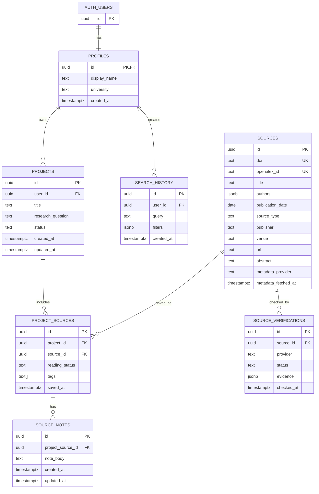
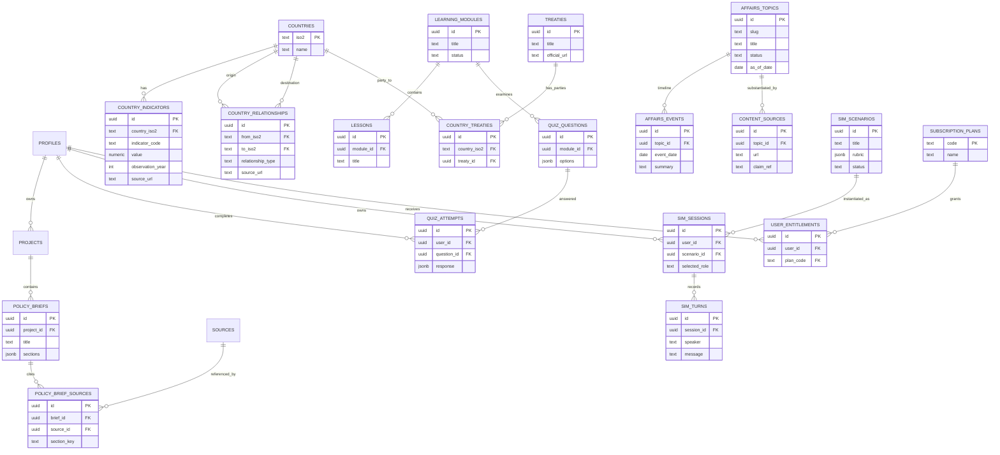

# Entity Relationship Diagram (ERD) and Data Dictionary

**ATLAS MVP | Logical and physical data model | v1.0**

## 1. Mermaid ERD

`AUTH_USERS` is `auth.users` managed by Supabase Auth. All other entities live in `public` in the provided SQL starter migration. `UK` denotes a unique identifier/index; for DOI the index is case-insensitive on `lower(doi)`.

## 2. Data dictionary

### `profiles`
- `id UUID PK`: exactly one profile per Auth user. Created by trusted trigger on signup.
- `display_name TEXT NULL`: optional student display name.
- `university TEXT NULL`: optional and unverified self-report.
- `created_at TIMESTAMPTZ NOT NULL`.
- Security: own record only.

### `projects`
- `id UUID PK`.
- `user_id UUID FK profiles.id NOT NULL`.
- `title TEXT NOT NULL`; recommended UI maximum 160 characters.
- `research_question TEXT NULL`.
- `status TEXT NOT NULL`: `active | archived`.
- `created_at`, `updated_at TIMESTAMPTZ NOT NULL`.
- Security: owner-scoped.

### `sources` — globally reusable publication metadata
- `id UUID PK` canonical internal identity.
- `doi TEXT NULL`: normalized without `https://doi.org/` prefix; unique case-insensitively when present.
- `openalex_id TEXT NULL UNIQUE`.
- `title TEXT NOT NULL`.
- `authors JSONB NOT NULL`: ordered author objects. Suggested `{ "given": "...", "family": "...", "sequence": 1, "orcid": null }`.
- `publication_date DATE NULL`.
- `source_type TEXT NULL`, `publisher TEXT NULL`, `venue TEXT NULL`, `url TEXT NULL`, `abstract TEXT NULL`.
- `metadata_provider TEXT NOT NULL`, `metadata_fetched_at TIMESTAMPTZ NOT NULL`.
- Security: authenticated read, ingestion-only write. Full-text copyright material is NOT stored by default.

### `project_sources`
- `id UUID PK`.
- `project_id UUID FK projects.id NOT NULL`.
- `source_id UUID FK sources.id NOT NULL`.
- `reading_status TEXT NOT NULL`: `unread | reading | read`.
- `tags TEXT[] NOT NULL DEFAULT '{}'`.
- `saved_at TIMESTAMPTZ NOT NULL`.
- `UNIQUE(project_id, source_id)` prevents duplicates.
- Security: owner determined through `project_id` join.

### `source_notes`
- `id UUID PK`.
- `project_source_id UUID FK project_sources.id NOT NULL`.
- `note_body TEXT NOT NULL`.
- `created_at`, `updated_at TIMESTAMPTZ NOT NULL`.
- Security: owner determined through project source → project; never globally readable.

### `source_verifications`
- `id UUID PK`.
- `source_id UUID FK sources.id NOT NULL`.
- `provider TEXT NOT NULL` (`crossref`, etc.).
- `status TEXT NOT NULL`: `verified | partially_verified | unknown | flagged`.
- `evidence JSONB NOT NULL`: narrow structured fields such as expected title, matching DOI, mismatch reason and retriever version; avoid storing irrelevant provider payloads.
- `checked_at TIMESTAMPTZ NOT NULL`.
- Security: authenticated read of evidence safe for display, trusted server write only. Avoid claiming peer-review or truth conclusions.

### `search_history`
- `id UUID PK`, `user_id UUID FK profiles.id NOT NULL`.
- `query TEXT NOT NULL`, `filters JSONB NOT NULL`, `created_at TIMESTAMPTZ NOT NULL`.
- Security: owner-scoped; UI should let user clear history. Set and disclose retention before enabling auto-save.

## 3. Cardinalities and deletion

| Relationship | Cardinality | Delete behavior |
|---|---|---|
| Auth user → profile | 1:1 | Auth deletion cascades profile |
| Profile → projects | 1:N | Profile deletion cascades projects |
| Project → saved sources | 1:N | Project deletion cascades join rows |
| Source → saved associations | 1:N | Source deletion cascades joins, but avoid routine deletion of referenced global sources |
| Project source → notes | 1:N | Removing saved association cascades notes; confirm destructive action in UI |
| Source → verifications | 1:N | Removing source cascades verification records |
| Profile → search history | 1:N | Profile deletion cascades history |

## 4. Integrity and privacy invariants

- Only a project's owner can view, modify or delete its join rows and notes.
- `project_sources` cannot point to nonexistent `projects` or `sources`.
- Duplicate source associations are blocked at the database layer.
- The public authenticated client never inserts or updates `sources` or `source_verifications`; use trusted backend writes.
- Store normalized provider metadata and `checked_at` to retain traceability.
- For missing/ambiguous DOI, do not merge publication metadata based solely on title similarity.
- If a student's project is removed, no copy of their notes remains attached to a shared source.

## 5. Suggested future schema extensions (not required for P0)

`source_identifiers`, `citation_export_jobs`, `project_members`, `institution_affiliations`, `primary_document_sources`, `source_integrity_notices`, `audit_events`. Do not add these unless an actual product workflow requires them.

---
## 6. Expanded ERD — whole ATLAS platform
The original research ERD remains valid as the shared evidence subsystem. These entities are added for the five product pillars and plan controls. Implementation SQL is in `schema.sql`.

### Expanded data dictionary and invariants
| Entity | Principal attributes | Ownership and integrity |
|---|---|---|
| `countries` | `iso2`, `name`, `region`, `metadata_updated_at` | public reference, trusted backend writes |
| `country_indicators` | ISO2, indicator code, observation year, numeric value, provider, source URL, fetched timestamp | composite unique country/indicator/year/provider; null is unknown, not zero |
| `country_relationships` | `from_iso2`, `to_iso2`, relationship type, summary, source URL, valid-as-of date | directed records; no unsupported scoring of friendship/conflict |
| `treaties` / `country_treaties` | title, official URL, signing date; party ISO2 and status | many-to-many; participation dates/status recorded explicitly |
| `affairs_topics` / `affairs_events` | title, summary, editorial state, as-of date; dated timeline entries | only `published` content student-readable |
| `content_sources` | topic, source URL, publisher, claim pointer, accessed date | multiple citations per explainer; no invented sources |
| `policy_briefs` / `policy_brief_sources` | owner via `projects`, typed sections JSON, bibliography source refs | project owner only; every cited source must be in owner's saved project library (API invariant) |
| `sim_scenarios` / `sim_sessions` / `sim_turns` | scenario content/rules/rubric; owner session; ordered turns | published scenarios globally read, sessions and turns owner-only |
| `learning_modules` / `lessons` / `quiz_questions` / `quiz_attempts` | curated lessons, choices, answer key, individual response | unpublished modules restricted, answer key never sent before submission |
| `subscription_plans` / `user_entitlements` | plan code, plan limits, effective period | server-only entitlement changes, user can read their own effective access |

### Privacy and deletion
Deleting a profile cascades private projects, briefs, quiz attempts and sim sessions. Curated public content survives user deletion; source metadata is shared and survives research-project deletion. Ownership-based RLS protects all student content. The service layer must enforce quotas, evidence associations, and content-publication states even where SQL keys alone cannot express them.
