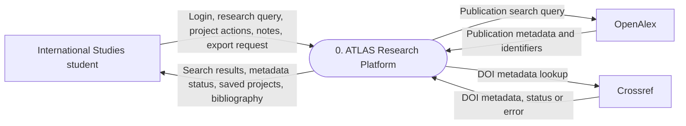
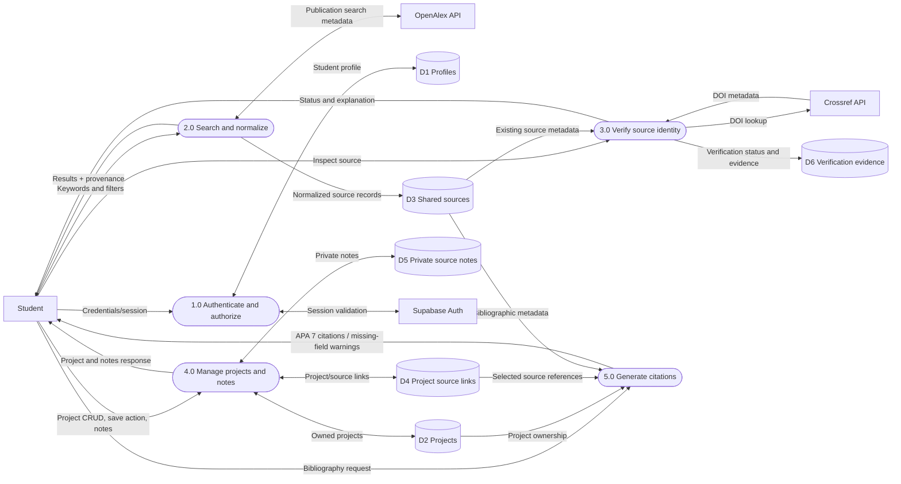
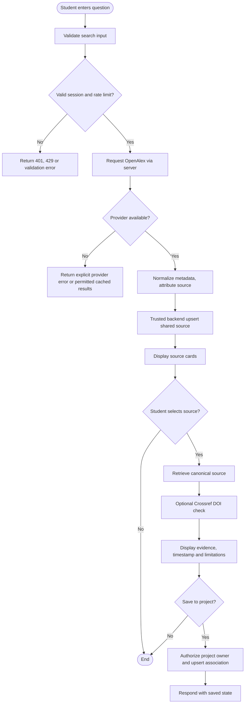
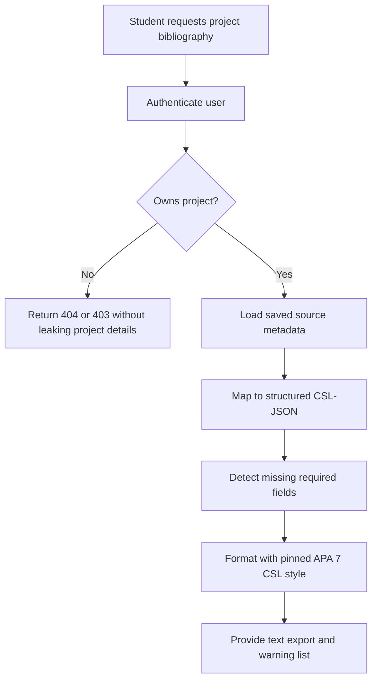
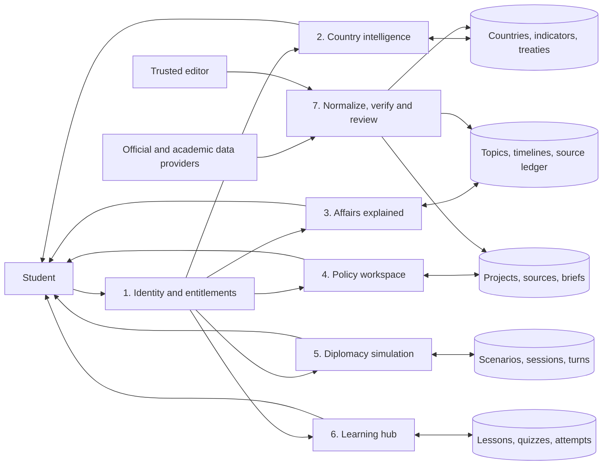
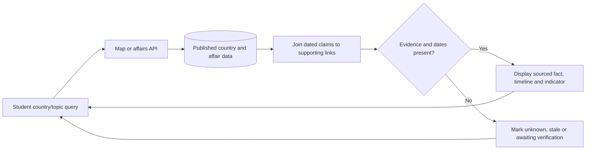
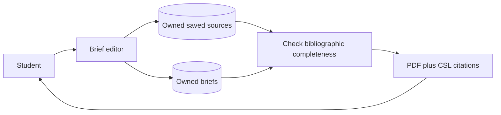
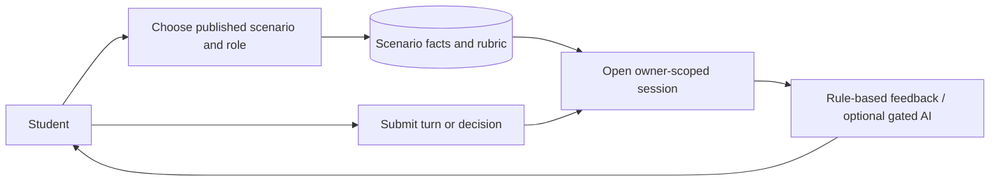
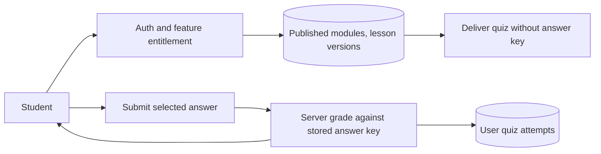

# Data Flow Diagrams (DFD)

**ATLAS MVP | Context and Level-1 diagrams | v1.0**

## DFD notation

- Square/rectangle: external actor or external service.
- Rounded node: transformation/process.
- Cylinder: persistent data store.
- Arrow label: actual information exchanged (not control-only arrows).

## Level 0 — System context

**Boundary:** Student data enters ATLAS through authenticated HTTPS; provider metadata enters from external systems and is treated as untrusted input. No notes or private project data are sent to OpenAlex or Crossref in P0; only user-entered search terms and publication identifiers as necessary.

## Level 1 — Decomposition

**Authorization note:** The diagram omits repeated calls to Process 1 for clarity. Each request to Processes 2–5 must authenticate (except any deliberately public read-only discovery route), enforce authorization and validate inputs. Data stores are logical and implemented in Supabase PostgreSQL.

## Detailed process: search, check, save

## Detailed process: bibliography

## DFD data inventory

| Data flow | Classification | Source → destination | Persistence |
|---|---|---|---|
| Credentials/session | Sensitive | Student → Auth service | Managed by Auth provider |
| Search terms | Potentially personal | Student → API → OpenAlex | Optional private history only |
| DOI / title metadata | Public or licensed metadata | Providers → service → shared source store | Yes, per provider terms |
| Verification evidence | Derived shared metadata | Crossref → service → verification store | Yes with timestamps |
| Project titles/questions | Private user data | Student → project store | Yes |
| Annotations | Private user data | Student → note store | Yes, scoped to owner |
| Bibliography output | User-specific derivative | Citation service → student | Generated on demand |

## Privacy principles

- Do not send private notes or full student project records to external research providers.
- Keep student authorization checks within every relevant process, not only at sign-in.
- Provider response data must never bypass validation before shared persistence or user-visible output.

---
## Level 1 expanded — all ATLAS pillars

### DFD 2A — map and affairs provenance

### DFD 2B — evidence-backed policy brief

### DFD 2C — diplomatic practice

### DFD 2D — learning and access control

**Data boundaries:** authenticated users can modify only personal projects, briefs, sim transcripts and quiz attempts. Editors publish shared content. Providers supply external evidence and never directly write trusted public tables. AI-generated text is labeled and cannot bypass publication review.
