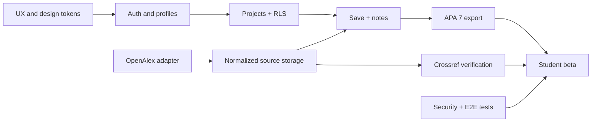

# Implementation Roadmap and Backlog

**Planning basis:** Solo/small engineering team, approximate six-week student beta. Estimates should be recalibrated after initial spikes.

## Dependency map

## Week-by-week phases

| Phase | Target | Build | Exit criteria |
|---|---|---|---|
| 0. Discovery | Before build / Week 1 | Interview 5–8 students, test screen flow, review API usage rules | MVP scope frozen; provider suitability checked |
| 1. Foundation | Week 1 | Next.js, Supabase, auth, database migration, RLS, navigation, projects | Two-user project isolation tests pass |
| 2. Discovery engine | Week 2 | Search API, OpenAlex adapter, normalization, pagination, source pages | Real provider results appear with provenance |
| 3. Evidence workspace | Week 3 | Crossref checks, source saving, notes, reading state, tags | Discovery-to-save journey passes |
| 4. Citation + quality | Week 4 | CSL APA 7, export, error states, accessibility, E2E | End-to-end flow passes, golden citation fixtures pass |
| 5. Closed beta | Weeks 5–6 | Recruit 15–20 students, observe tasks, prioritize defects | Acceptance gates and privacy/security checks pass |

## Epics and backlog

| ID | Priority | Story | Acceptance |
|---|---|---|---|
| E01-S01 | P0 | As student, I can sign in and sign out | Invalid sessions cannot access private API |
| E01-S02 | P0 | As student, I can create/rename/archive/delete a project | Project list restricted to owner |
| E02-S01 | P0 | As student, I can search academic metadata | Query/filters validated, real provider records |
| E02-S02 | P0 | As student, I can paginate and filter results | Stable paging, provider mapping documented |
| E02-S03 | P0 | As student, I can inspect original source and provenance | DOI/provider/source link visible |
| E03-S01 | P0 | As student, I can see DOI identity check | `unknown` used if not corroborated |
| E03-S02 | P0 | As student, I can save a source to my project | Unique project-source link; idempotent |
| E03-S03 | P0 | As student, I can annotate/track reading state | Notes are private to owner |
| E04-S01 | P0 | As student, I can preview an APA 7 bibliography | Citation fixtures pass |
| E04-S02 | P0 | As student, I can export citations | Warnings shown for incomplete metadata |
| E05-S01 | P0 | As developer, I have RLS tests | Cross-user accesses denied |
| E05-S02 | P0 | As operator, I can identify outages | Sanitized telemetry and alarms |
| E06-S01 | P1 | As student, I can browse official document sources | Reviewed official links; not full-text scraping |
| E06-S02 | P1 | As student, I can reuse recent searches | Opt-in history and delete controls |

## Release quality gates

1. Complete J1/J2/J3 in PRD without mock data.
2. No critical cross-user data exposure, XSS, SSRF or leaked secret in testing.
3. Provider errors and incomplete records are handled without hallucinations.
4. APA 7 citations pass test corpus and show missing field warnings.
5. Responsive keyboard-operable flows, acceptable load/latency metrics.
6. At least 15 testers complete representative tasks; record their success rates and feedback.

## Explicitly deferred

Collaborative sharing, instructor dashboard, subscriptions, AI literature summaries, global affairs dashboards and native apps. Revisit only after students demonstrate research workflow value.

---
## Whole-platform phased delivery roadmap
The original 4–6 week estimate applies to the **research foundation only**. Adding all five modules changes schedule and engineering scope. These are planning ranges for a small team, dependent on curated content availability and provider approvals.

| Phase | Approximate duration | Deliverables | Dependencies / gate |
|---|---|---|---|
| F0: Research backbone | 4–6 weeks | Auth, OpenAlex, Crossref, research library, APA 7, saved projects, source integrity | complete end-to-end evidence workflow |
| F1: Platform shell + data | 2–3 weeks | Global navigation, feature flags, country + affairs schema, entitlement scaffold, read-only module landing pages | coherent shared design and auth |
| F2: MAP + AFFAIRS | 4–6 weeks | Country profiles, two-country comparison, sourced issue explainers and timelines, curated editorial workflow | original source links and update policy |
| F3: POLICY | 3–5 weeks | Sectioned policy editor, source attachments, bibliography PDF, basic rubric warning system | stable citation metadata/export |
| F4: SIM + LEARN | 4–6 weeks | Scripted diplomat simulator with debrief, curated lessons, source-linked quizzes and student progress | reviewed content, server grading |
| F5: Beta and commercialization | 2–4 weeks | Accessibility, load/security testing, analytics, quota checks, optional Student trial | 15–20 student testers and feedback |

### Epics and dependencies
- **E01 Shared platform:** unified navigation, auth, profiles, server-accessible feature flags, user entitlements, audit trail.
- **E02 Research (dependency):** credible evidence retrieval, provenance, citations, secure projects.
- **E03 MAP:** ISO country seed, indicator adapters, sourced treaties and relationships, map interaction and comparison.
- **E04 AFFAIRS:** topic/editorial CMS, source ledger, dated claims and timeline components.
- **E05 POLICY:** structured brief content, source linking, PDF export and completeness validation.
- **E06 SIM:** reviewed scenarios, roles, transcript storage, deterministic branching, rubric debrief; optional AI separately gated.
- **E07 LEARN:** taxonomy, versioned content, quizzes, server-side grading, progress dashboards.
- **E08 Pricing:** Free/Student plan flags with hypothesized ₱99/month, metered usage and trial; actual billing deferred until price validation.

### Sequencing rule
Visible module entrypoints can exist in F1 as *clearly labeled previews*; never call a placeholder fully launched. No AI dependency is allowed to block the five deterministic/sourced workflows. Each phase must pass private-data isolation tests and accessibility checks before general release.
