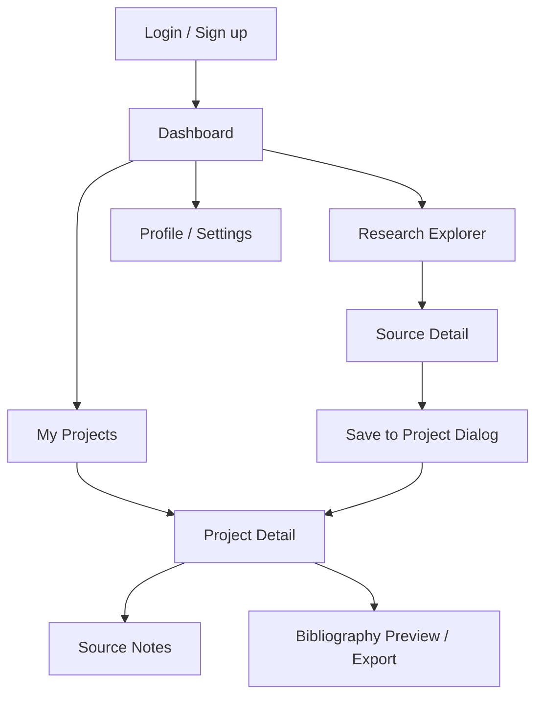
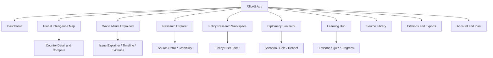

# UX Information Architecture and Screen Requirements

**ATLAS MVP | Student-facing web app | v1.0**

## 1. Navigation tree

## 2. Screen inventory

| Screen | Main content | Primary CTA | Empty/error states |
|---|---|---|---|
| Sign in/up | Email auth, app value proposition | Continue | Invalid credentials, verification needed |
| Dashboard | Recent projects, counts, recent activity | New project / Start research | First project prompt |
| Research Explorer | Query, filters, paginated results | Search | No results, provider unavailable, loading |
| Source Detail | Title, authors, DOI, venue, original link, provider, status | Save source | Unverified DOI, incomplete metadata |
| Project list | Owned projects, status, last modified | Create project | No projects |
| Project Detail | Saved sources, status, tags, note count, bibliography | Add sources / Export | No saved sources |
| Source notes | Project-specific notes and reading status | Save note | No notes, save error |
| Export preview | APA 7 references and missing-field warnings | Copy / Export text | Empty selection, missing fields |
| Settings | Profile and research history controls (if enabled) | Update profile | Session expiry |

## 3. Source card specification

Display title (up to 2–3 lines), ordered first authors, publication year, source type, venue, DOI available/missing, OpenAlex attribution, and original-source action. Verification UI distinguishes metadata match from scholarly quality. A `Save` button opens project picker and shows the saved state after success.

### Verification badges

- **Metadata verified:** Matching DOI and bibliographic fields from corroborating provider.
- **Partially verified:** Some identity fields match; others unknown or materially different; explain exactly.
- **Not checked / Unknown:** Provider unavailable or no suitable identifier.
- **Flagged for review:** Evidence of contradictory identity metadata or credible integrity notice; explain and provide link when possible.

Never display “100% trustworthy,” “fact checked,” or “peer reviewed” unless individually supported by sufficient evidence.

## 4. Visual direction

- Minimal, premium, academic appearance; navigation hierarchy more important than decorative visuals.
- Dark navy and slate with accessible light-mode option; subtle blue accent reserved for actions and links.
- Desktop: fixed left sidebar + main pane + optional right context pane on source detail.
- Mobile: condensed navigation, full-width search, persistent source actions within reason.
- Typography: legible sans-serif for UI, optional serif used sparingly for document previews.
- Give real publication titles ample space, avoid dense metric dashboards unrelated to research.

## 5. Interaction standards

- Always show provenance and `metadataFetchedAt` for source records.
- Saving sources must persist across sessions, with clear feedback.
- Provide destructive-action confirmations for removing a project/source when notes will be deleted.
- Use skeleton/loading states for external searches and direct retry for provider failures.
- Provide accessible form errors and keyboard-operable dialogs.
- Export preview must show warnings before generation when metadata is incomplete.

---
## Expanded information architecture — full ATLAS

### Added screen requirements
| Screen | Components | Primary CTA | Empty / error behavior |
|---|---|---|---|
| Map overview | map, country search, selectable list alternative, legend, last-updated badge | Explore country | map unavailable → accessible country list |
| Country details | flag/name, government, source-dated stats, treaties, relationships, compare tray | Compare | no indicators → `No verified data available` |
| Affairs feed | topic cards, region/date filters, factual vs analysis labels | Open issue | stale feed warning |
| Affairs explainer | chronology, stakeholder cards, perspective sections, source ledger | Save research source | missing claim provenance visibly flagged |
| Policy workspace | project list, structured brief blocks, citations panel, source drawer | Export brief | missing references prompts validation, not invented text |
| Simulator lobby | scenario cards, difficulty, learning objectives, role selection | Start simulation | no scenarios → curated coming-soon state |
| Simulator session | chat/turns, role info, supporting evidence, timer optional | Submit / finish | simulated nature prominent; resume support |
| Simulation debrief | rubric criteria, evidence used, transcript recap | Save reflection | do not label political opinion objectively correct |
| Learning hub | modules, objectives, estimated time, progress | Begin lesson | no lessons → transparent availability |
| Quiz | question, answers, explanations, sourced references | Submit answer | maintain accessible keyboard navigation |
| Plan/limits | Free vs Student comparison, quota usage, price test wording | Join trial | no live checkout until payment integration |

### Information hierarchy
Left sidebar: Dashboard / Intelligence Map / World Affairs / Research Explorer / Policy Workspace / Diplomacy Simulator / Learning Hub / Library / Citations / Settings. On small screens, use grouped mobile navigation plus module index rather than crowding eleven bottom-nav icons. Research remains the shared evidence entry point inside other pillars.
