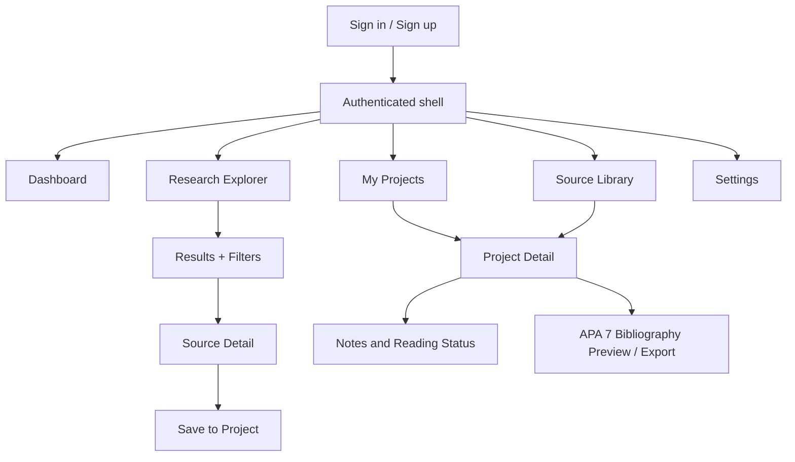

> Current implementation override: ATLAS is a personal, non-subscription application. Plan/pricing concepts in historical planning documents are superseded. AI study/OCR and Microsoft Edge neural speech are enabled through explicit user actions; generated text remains distinct from verified source metadata.

# ATLAS — Design System & UI/UX Specification

**Product:** ATLAS — International Studies Platform  
**Organization:** NEXT Technology  
**Version:** 2.1 — Brand identity alignment | **Date:** 2026-11-11  
**Status:** Implementation specification; not a finished design mockup  
**Related documents:** `01_PRD.md`, `09_UX_Information_Architecture.md`, `05_API_Specification.md`, `08_Test_and_Acceptance_Plan.md`

## 1. Design brief

### Product identity

**Tagline:** Understand the world. Analyze events. Think like a diplomat.

ATLAS is an integrated academic platform for International Studies students spanning a Global Intelligence Map, World Affairs Explained, Policy Research Workspace, Diplomacy Simulator, and Learning Hub. Credible-source discovery and evidence evaluation underpin all five modules. The interface must foreground learning and research rather than decorative dashboards.

### Design principles

1. **Evidence before aesthetics:** publication title, author, provenance, original link, and limitations remain prominent.
2. **Clarity over automation:** explain what ATLAS checked; never label a source “credible” solely because its DOI exists.
3. **Evidence-connected:** every module can connect back to sources, annotations, and citations, while keeping module-specific workflows distinct.
4. **Editorial and cartographic:** meaningful hierarchy, precise gridding, map cues and disciplined whitespace without decorative gloss.
5. **Accessible by default:** usable with keyboard, screen readers, touch, and narrow/mobile screens.
6. **Honest system states:** no fabricated search results, unsupported peer-review claims, or imaginary precision scores.

### Personality

Professional, scholarly, contemporary and deliberate. Avoid militaristic intelligence-agency styling, generic AI dashboard tropes, oversized hero panels, glowing globes, gratuitous cards, gold-on-black ornamentation, fake statistics and chat-first layouts. Brand illustrations must communicate actual navigation or geographic context.

## 2. Design tokens

Use CSS custom properties through Tailwind's theme integration. Suggested palette below is a proposed design system, not an existing brand requirement.

### Color tokens — approved design direction

The identity uses **graphite + slate + cobalt + ivory + mist**. White backgrounds and the lighter editorial workspace are preferred for source reading. Dark mode is an accessible alternative, not the dominant visual style. These colors are **proposed brand values from the identity concept** and must be visually and contrast-tested before production.

| Token | Light | Dark | Usage |
|---|---|---|---|
| `--background` | `#F7F4EB` | `#1A1D24` | Application canvas |
| `--foreground` | `#1A1D24` | `#F7F4EB` | Main typography |
| `--surface` | `#FFFFFF` | `#242A33` | Workspace panels, sheets |
| `--surface-muted` | `#E2E5EA` | `#323843` | Secondary pane, hover |
| `--border` | `#CED3D9` | `#4B5563` | Rules and borders |
| `--muted-foreground` | `#4B5563` | `#CED3D9` | Secondary text |
| `--primary` | `#1F5BFF` | `#79A0FF` | Active navigation, focus, actions |
| `--primary-foreground` | `#FFFFFF` | `#101725` | Labels on primary actions |
| `--success` | `#166534` | `#86EFAC` | Verified *bibliographic metadata* only |
| `--warning` | `#92400E` | `#FCD34D` | Incomplete / uncertain verification |
| `--danger` | `#B91C1C` | `#FCA5A5` | Errors, conflicting metadata |
| `--focus` | `#1F5BFF` | `#9AB7FF` | Accessible keyboard focus ring |

**Usage ratio (guidance):** 70–80% neutral surfaces, 15–25% graphite/slate typography and rules, less than 10% cobalt actions/highlights. Do not use cobalt for long-form body text. Do not rely on gold, gradients or shadows to establish brand identity.

**Contrast policy:** check WCAG 2.2 AA for all actual text / background combinations, badges, controls, and both modes. Ensure verification statuses use explanatory text rather than color alone.

### Typography

- **Primary UI:** Inter with `system-ui` fallback; 14–16px for controls, 16px for reading content.
- **Editorial display:** Source Serif 4 for selected article titles, issue headers and long-form reading, not tables or dense form fields.
- **ATLAS wordmark:** custom-spaced geometric sans lettering / approved vector artwork; **do not** substitute a generic heading style for the master logo.
- **Page heading:** 26–32px / 1.2; **section heading:** 18–22px / 1.3; **body:** 16px / 1.55–1.7; **metadata:** 12–14px with accessible contrast.
- **Numerical data / citations:** aligned tabular numerals where needed; hanging-indent bibliography formatting preserved.
- Reserve ALL CAPS with wide tracking for brief metadata labels and the logo subtitle, never for substantial paragraphs.
- Fonts are implementation choices; do not embed unlicensed proprietary font files.

### Spacing and geometry

- Base scale: `4, 8, 12, 16, 20, 24, 32, 40, 48, 64` px.
- Cards: 16–20px padding; major panels: 24px on desktop, 16px on mobile.
- Radius: input/button 8px, cards 12px, modal 16px; avoid excessive rounding.
- Borders: 1px neutral border; shadows subtle and optional.
- Touch targets: target at least 44×44 CSS px for primary mobile interactions where feasible.
- Content max width: 1200px overall; 760–820px for reading-focused panes.
- Animation: 120–200ms, avoid unnecessary motion; respect `prefers-reduced-motion`.

## 2A. ATLAS identity system — master specifications

The approved **direction** is Concept 2 from the brand exploration: an **abstract letter A integrated with a compass/meridian circular instrument**. It combines navigation, geography and academic inquiry without requiring an illustrative world map at tiny sizes. The imagery shown in concept renders is a reference, **not an approved SVG master or ready-to-ship icon set**. A production designer must construct and QA clean vector artwork.

### Core mark geometry

- **Symbol:** a strong geometric `A`/northward needle centered inside a restrained meridian circle. One intentional interruption in the circle/meridian can suggest exploration; keep geometry balanced.
- **Grid treatment:** 2–3 controlled meridian/latitude strokes at large sizes; reduce or remove interior detail at small sizes. Avoid a detailed continent silhouette in the favicon.
- **Accent:** a single cobalt arc or short navigational sweep; never multiple unrelated swooshes.
- **Silhouette:** recognizable in one color, including grayscale, embossing, and a 16px tab.
- **Clear space:** at least 25% of symbol height around standalone symbol; at least the height of the capital `A` on horizontal lockups.
- **Minimum size:** icon-only master 24px in standard UI; use optical simplified favicon below 24px. Wordmark lockup minimum width 140px where tagline is excluded.
- **Avoid:** generic globe stock art, overloaded compass points, fine continent detail, gradients, bevels, random cartographic scribbles, unnecessary 3D, distorted aspect ratio, and decorative mock data.

### Asset deliverables

| Asset | Source / exported sizes | Layout and usage | Background |
|---|---|---|---|
| **Primary logo** | `logo-horizontal.svg`, PNG at 1x/2x | Symbol to left of `ATLAS`; `International Studies Platform` optional below in wide usage | Light / dark variants |
| **Stacked logo** | `logo-stacked.svg` | Centered symbol and wordmark for onboarding, splash, cover | Transparent light / dark |
| **App icon** | `app-icon.svg`, `app-icon-1024.png`, `app-icon-512.png`, `app-icon-192.png` | Center symbol in square with 16–20% interior safe margin; optical alignment; no text | Solid graphite, optional alternate cobalt |
| **Favicon** | `favicon.svg`, `favicon.ico` containing 16/32/48, PNG 32/48 | Simplified A/needle or compass-A silhouette; remove latitude grids if muddy | Solid / transparent, tested on browser tabs |
| **Sidebar banner** | `sidebar-brand.svg`, `sidebar-brand-1200x300.png` | 4:1 horizontal composition; symbol + ATLAS wordmark + optional subtitle; keep the central area visually calm | Graphite / ivory variants |
| **Collapsed sidebar** | `sidebar-mark.svg` | Standalone compass-A mark; no wordmark | Light / dark |
| **Social / Open Graph** | `og-atlas-1200x630.png` | Larger lockup and concise tagline; not the compact sidebar banner | Editorial, high contrast |

**Sidebar brand specifications:** standard expanded navigation header 232–264px wide with 20px inner padding. Display logo at approximately 170–200px wide and 40–56px high. On collapsed sidebar (64–80px wide) show symbol at 28–32px only. Do not display the full 1200×300 banner as an enormous card inside the navigation. If a separate branded horizontal header is used, scale the 4:1 banner proportionally and provide a text equivalent for assistive tech.

### Brand variants and QA

1. Create single-color graphite and single-color white symbol/wordmark masters before applying cobalt.
2. Validate favicon at 16px, 32px, and 48px; if not immediately identifiable, remove lines rather than sharpening small details.
3. Verify optical centering, consistent stroke weight, readable wordmark kerning, and absence of unintended asymmetry.
4. Test on ivory, pure white, graphite and photo-free app backgrounds.
5. Export SVG with controlled viewBox and minimal paths; sanitize SVG and provide PNG/ICO fallbacks. Text in final identity assets should use vector outlines or a reliable rendering strategy, rather than depend on missing fonts.
6. Store source artwork under `public/brand/` and record designer/source/version in a brand asset manifest.

### Brand applications across modules

- **Global Intelligence Map:** cobalt represents active selection and map layers; geographical distinctions must remain legible without relying solely on color. Symbol is restricted to UI navigation, not stamped over the map.
- **World Affairs:** article-first editorial typography, date, sourcing, update and perspectives; do not use stock crisis imagery for decoration.
- **Policy Research:** document-editor canvas, sources and citation panel; restrained neutral workspace with cobalt indicating selections and linked citations.
- **Diplomacy Simulator:** meeting-room logic, speaker timeline, delegations and status, visually communicated through clear participant affordances; no game-like gold trophy aesthetic.
- **Learning Hub:** structured readings, exercises and relationship diagrams with progress tied to actual assessments; no fake mastery percentages.

### Design do-not-use list

No generic glassmorphism, persistent three-column dashboard widgets, giant hero greeting on work screens, fake real-time geopolitical counters, AI-generated sample article titles presented as verified records, ornamental globe wallpapers, neon routes, random photography, or dense card grids as the default layout. Each module gets a task-specific interaction model with a coherent shared visual language.

## 3. Responsive application shell

### Desktop ≥ 1024px

```text
┌──────────────────┬────────────────────────────────────────────────┐
│ ATLAS            │ Search / project breadcrumb      Account      │
│                  ├────────────────────────────────────────────────┤
│ Dashboard        │ Page title + contextual actions                │
│ Research Explorer│                                                │
│ My Projects      │ Primary workspace                              │
│ Source Library   │ Search / results / source information          │
│                  │                                                │
│ Settings         │                                                │
└──────────────────┴────────────────────────────────────────────────┘
```

- Sidebar 224–248px wide; collapsible to icons only if labels retain accessible names/tooltips.
- Main viewport fluid, max-width aligned, comfortable horizontal margins.
- Source Detail may have a 280–320px right provenance/notes rail only when space supports it.

### Tablet 768–1023px

- Collapsed navigation drawer; full-width main content.
- Filters may occupy a side drawer, never obscure search results persistently.
- Source details move to one main column.

### Mobile < 768px

- Top bar with app identity and menu; drawer navigation with explicit labels.
- Single-column search/results and one prominent “Save source” action per card.
- Filters open in an accessible sheet/dialog with Apply and Clear.
- No horizontal-scroll data tables required for essential information.
- Long citations wrap and preserve hanging indentation where possible.

## 4. Information architecture



Navigation names should match `09_UX_Information_Architecture.md`. `Source Library` is a cross-project view of the authenticated student's saved references, not a public document repository.

## 5. Page-level specifications

### 5.1 Authentication / onboarding

**Goal:** secure access with minimal friction.

- Login/register panel with product value statement, email/password (or approved email-link path), validation feedback, and password recovery.
- Offer university as an optional profile field; do not block account creation.
- Do not promise access to paywalled academic papers.
- State that research records may link to third-party providers.

**States:** empty, invalid field, credentials failed, verification required, submitting, session expired.

### 5.2 Dashboard

**Goal:** resume research quickly.

- Page title: “Your research workspace”.
- Primary CTA: **New research project**; secondary CTA: **Explore sources**.
- Recent projects: title, research question snippet, saved-source count, last updated.
- Avoid unsupported badges such as “research accuracy 97%”.
- Empty state: “Create your first project to organize sources, notes and citations.”

### 5.3 Research Explorer (flagship screen)

**Goal:** find scholarly publications, inspect metadata, and save useful sources.

Layout order: heading → prominent search field → filter row → result count/provider status → results list → pagination.

Filters for P0: publication year range, source type (when reliably provided), open-access indicator (when reliably provided), sort (relevance/newest). Only expose filters supported by the provider/query contract.

**Result card anatomy:**

```text
┌─────────────────────────────────────────────────────────────────┐
│ JOURNAL ARTICLE    •    2023       Metadata: not yet verified    │
│ Article title with enough room for accurate wording             │
│ Author A, Author B  ·  Journal / venue                           │
│ Abstract or searchable excerpt, if permitted                     │
│ DOI available  ·  Source: OpenAlex  ·  Updated: [timestamp]        │
│ [View source details] [Open original ↗] [Save to project]         │
└─────────────────────────────────────────────────────────────────┘
```

- External links open to their true destinations; use safe link attributes for new tabs.
- Always distinguish original publication links from metadata-provider records.
- Search response must not be replaced with fictional or generated results if unavailable.
- “No results” suggests revised keywords, without claiming no literature exists.
- If the provider times out, show a retry action and partial-results explanation when relevant.

### 5.4 Source Detail and verification

**Goal:** help a student determine whether the reference is real and useful.

Sections, in order:
1. Full citation metadata: title, authors, year/date, venue, publisher, DOI, source type.
2. Original-source link, DOI link, and metadata-provider attribution.
3. **Verification status with explanation** (see status matrix).
4. Abstract when legally available; show attribution/rights if needed.
5. Relevance considerations (manual checklist in P0, not a fabricated AI verdict).
6. Save to Project, with multi-project choice and a persistent saved indication.

| Status | Label | Meaning | Visual treatment |
|---|---|---|---|
| `verified` | Bibliographic metadata matched | Independent records corroborate selected identity fields | Calm success icon + explanation |
| `partially_verified` | Partially matched | Selected fields match but details are missing/unclear | Neutral/warning icon + field details |
| `unknown` | Not verified | No suitable corroboration / not yet checked | Neutral icon, no credibility verdict |
| `flagged` | Needs review | Evidence conflicts or noteworthy publication notice | Warning/error icon + source of concern |

**Never render:** “100% credible,” “true article,” automatic “peer reviewed” based only on DOI, or a generic quality percentage without defensible methodology.

### 5.5 My Projects and Project Detail

- List projects with title, question, status, source count and last modified.
- Create project dialog: required title, optional research question; clear errors.
- Inside project: header, saved sources, tags, reading status, private notes, citation export.
- Preserve notes by attaching them to `project_sources` rather than a shared global source.
- Confirm destructive removal when attached notes would be deleted.

### 5.6 Source Library

- Cross-project view of personally saved references, searchable by title/author/DOI and filtered by project or reading status.
- Same source can appear in more than one project but notes/tags stay project-scoped.
- Clearly label which project a note belongs to.

### 5.7 Citation Preview / Export

- Choose selected sources or all saved sources in one project.
- Primary citation style: APA 7. Use verified structured metadata and a CSL processor.
- Show bibliography preview, copy citation(s), export `.txt` (and PDF only if specifically implemented and tested).
- Warn for missing year/author/venue fields; never invent them.
- Preserve citations as research aids; students must review their institution's style requirements.

## 6. Component inventory and variants

| Component | Variants / states | Guidance |
|---|---|---|
| `AppSidebar` | Expanded, collapsed, mobile drawer | Active route and visible keyboard focus |
| `PageHeader` | Title, subtitle, actions | One clear primary action |
| `SearchInput` | Idle, typing, loading, invalid | Submit by Enter and button; clear label |
| `FilterBar` | Default, active, mobile sheet | Chip labels show applied filters |
| `SourceCard` | Default, saved, loading | Bibliographic identity and provenance first |
| `VerificationBadge` | Verified, partial, unknown, flagged | Color + icon + text; always explainable |
| `SourceMetadata` | Complete, partial | Missing field explicitly “Not available” |
| `ProjectCard` | Active, archived | Whole card not required to be clickable |
| `ProjectPickerDialog` | Empty, selected, saving, error | Focus-trapped and keyboard accessible |
| `NotesEditor` | Empty, modified, saving, saved, failed | Explicit persistence feedback |
| `CitationPreview` | Valid, warning, empty | Format deterministically via CSL |
| `EmptyState` | First use, no results, no project | Explain next step; one useful CTA |
| `ErrorState` | Network, auth, provider, unknown | Safe messaging, retry where possible |
| `LoadingSkeleton` | Search result, project list, detail | Prevent layout shifts |
| `Toast` | Success, failure | Does not replace persistent field errors |

### Component interaction requirements

- Buttons must have actual actions; never use decorative “save” buttons.
- Interactive cards must not nest buttons inside buttons or links inside links.
- Dialogs must trap focus, restore focus on close, and support Escape where appropriate.
- Confirm asynchronous persistence from server results before displaying “Saved”.
- Show backend failures without leaking secrets, raw stack traces, or sensitive identifiers.

## 7. UX writing guidelines

**Recommended:**
- “Bibliographic metadata matched with Crossref.”
- “This source has not been independently verified.”
- “Open the original publication.”
- “Saved to ASEAN Security Cooperation.”
- “Some citation fields are missing. Please review before submitting.”

**Avoid:**
- “This is a trustworthy article.”
- “ATLAS has verified the research findings.”
- “100% credible source.”
- “Full text available” unless there is a verified accessible full-text link.

Error messages must say what happened and what the student can do next. For example: “Academic search is temporarily unavailable. Your saved sources are safe. Try again.”

## 8. Accessibility, internationalization, performance

- Target **WCAG 2.2 AA**; validate keyboard navigation, contrast, focus order, dialog behavior, form errors, and screen-reader announcements.
- Use semantic headings, meaningful control names, and `aria-live` for result count/status changes.
- Support 200% text zoom and responsive layout without clipping essential controls.
- Use ISO dates in data; present human-readable dates consistently and identify dates of retrieval where useful.
- Allow Unicode author names and publication titles; do not assume ASCII-only metadata.
- Limit motion and respect reduced-motion settings.
- Optimize for mobile connections: lazy-load noncritical panes, paginate search results, debounce keyword suggestions but do not block normal search submission.
- Never make AI generation a prerequisite for viewing search results or existing projects.

## 9. Frontend folder structure (suggested)

```text
src/
  app/
    (auth)/login/page.tsx
    (app)/dashboard/page.tsx
    (app)/research/page.tsx
    (app)/projects/page.tsx
    (app)/projects/[projectId]/page.tsx
    (app)/library/page.tsx
    (app)/settings/page.tsx
    api/
  components/
    layout/
    research/
    projects/
    citations/
    ui/
  lib/
    api/
    auth/
    citations/
    source-normalization/
    validations/
  styles/
    globals.css
```

Use feature-based React components and keep provider adapters/server secrets out of client bundles. Pair each stateful component with loading, success, empty, and error stories or tests.

## 10. Design acceptance criteria

- [ ] Student can reach search from Dashboard in one action.
- [ ] Every visible search result clearly identifies its metadata origin and an original-record/publisher link when available.
- [ ] Source verification never implies factual accuracy or peer review without specific evidence.
- [ ] Save-to-project confirms success only after server acknowledgment.
- [ ] Source notes remain project-scoped and private.
- [ ] Citation preview visibly warns when bibliographic metadata is incomplete.
- [ ] Search, project management, and bibliography export work at 360px, 768px, and desktop widths.
- [ ] Keyboard-only users can complete the core search → inspect → save → cite journey.
- [ ] Dark and light color combinations pass relevant accessibility checks.
- [ ] External provider and session failures provide safe and actionable feedback.

### Brand identity acceptance checks

- [ ] Logo, icon, favicon and sidebar banner are sourced from one approved compass-A vector master.
- [ ] App icon and favicon are each legible at their target sizes; the favicon has an optical small-size variant.
- [ ] Sidebar displays correct expanded and collapsed identities and does not stretch or crop the master artwork.
- [ ] Color and typography match the graphite/slate/cobalt/ivory/mist tokens in both modes.
- [ ] None of the five platform modules are reduced to identical dashboard cards; each follows its task-specific interaction design.
- [ ] All illustrative geopolitical, academic and statistical content is flagged as sample content until backed by real data.

## 11. Explicitly deferred design work

Not part of the MVP: diplomacy simulation, interactive geopolitical maps, chatbot-centric global affairs assistant, institution administration, group collaboration, billing, mobile native apps, and animated marketing experiences. These must not obscure or delay the research-first workflow.

---

**Implementation priority:** Create a polished `Research Explorer` and `Source Detail` experience before decorating the Dashboard. The product's visual credibility depends on transparent evidence presentation and functional research tools—not elaborate visuals.

---
## 16. Full-platform component system and page blueprints
These screens extend the initial research-first UI; they reuse the same surfaces, typography, navigation, source badges and responsive behavior. Both light and dark themes support all five pillars. No module should invent a separate visual language.

### Global application shell
- Product header: ATLAS wordmark, global search (countries/topics/papers), notification center (optional), user menu and plan indicator.
- Desktop sidebar groups: **Explore** (Intelligence Map, World Affairs), **Research** (Research Explorer, Policy Workspace, Library, Citations), **Practice** (Diplomacy Simulator, Learning Hub), **Account** (Settings/Plan).
- Tablet/mobile: navigation drawer with semantic section headings; command-search opened via persistent search button; hide optional side panels behind accessible tabs.
- A consistent provenance component `SourceLedger` displays source name, URL, published date, retrieved/reviewed date and fact vs analysis status.

### Screen 8 — Global Intelligence Map (`/intelligence`)
**Composition:** globe/map canvas 65% and country index 35% desktop; stacked panels mobile. Top row includes region picker, indicator picker, observation year and compare mode. Clicking a country opens a fact-sheet drawer with `CountryFact`, `IndicatorTable`, `TreatyList`, `RelationshipList` and clear `Data as of` labels. Two-item comparison tray opens `/intelligence/compare?countries=PH,JP`. Provide a text/list alternative to the map. Never assign ungrounded red-green 'alliance' scoring or draw authoritative disputed boundaries.

### Screen 9 — World Affairs Explained (`/affairs`)
Editorial cards show issue title, region, review date and source count. Topic page includes **Snapshot**, **What happened**, **Timeline**, **Stakeholders**, **Different perspectives**, **Evidence and limitations**. Each factual claim can reveal `SourceLedger` and editorial review date. `Save to Research` links source records into a project; don't save naked AI assertions.

### Screen 10 — Policy Workspace (`/policy`)
Two-column desktop: 68% brief editor, 32% evidence/citation drawer. Tabs: Overview, Stakeholders, Policy Options, Risks, Recommendation, Bibliography. Structured `PolicyOptionCard` includes policy, benefits, costs, stakeholders and evidence. Show citation coverage meter **only as a completeness indicator**, not truth probability. Export displays missing-citation warnings and APA 7 options; mobile uses bottom-sheet evidence picker.

### Screen 11 — Diplomacy Simulator (`/simulations`)
Lobby includes scenario cover, region, difficulty, role choices, factual scenario date and learning outcomes. Session is three-part desktop: role brief, dialogue/choices, evidence/rules; mobile collapses role and evidence into tabs. A persistent label states **Fictional educational simulation**. `DebriefRubric` offers qualitative feedback with examples from student's own decisions. Make simulated characters distinguishable from real diplomats; never depict an AI answer as an official statement.

### Screen 12 — International Studies Learning Hub (`/learn`)
Module grid for IR theory, international law, international organizations, global history, geography and treaties. Lesson reading view has outlined objectives, short sections, date/source footnotes and quick-check cards. Quiz view shows one question at a time with visible answer progress and feedback. Progress bar reflects completion, not institutional accreditation. Use keyboard-operable radio buttons and explicit explanation after submission.

### Screen 13 — Account and Plan (`/settings/plan`)
Accessible table of Free vs proposed Student (₱99/month hypothesis), limits, features and trial status. Show a non-billing **Join interest list** or **Request beta access** control at pre-payment stage. No payment processor/checkout is part of the first platform slice.

### New reusable components
`CountrySelector`, `CountryFact`, `IndicatorStat`, `CountryCompareTable`, `GeopoliticalMap`, `WorldAffairsCard`, `EventTimeline`, `StakeholderPanel`, `PerspectiveTabs`, `SourceLedger`, `PolicyBriefEditor`, `PolicyOptionCard`, `EvidencePicker`, `CitationCoverageWarning`, `SimulationScenarioCard`, `RoleSelection`, `SimulationTranscript`, `DebriefRubric`, `LearningModuleCard`, `LessonReader`, `QuizQuestion`, `LearningProgress`, `PlanLimits`.

### Visual / interaction states for every module
Loading = meaningful skeleton or map list fallback; empty = actionable explanation; error = retry with preserved context; stale data = date and retrieval badge; unverified data = neutral label; saved personal content = authenticated state confirmation. All badges must include text, not color alone. Dark mode uses the existing design tokens; editorial maps and data charts need independently checked contrast and accessible legends.
